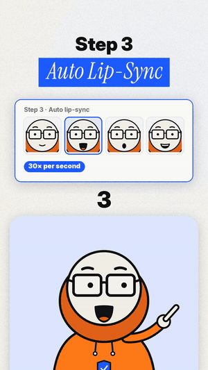
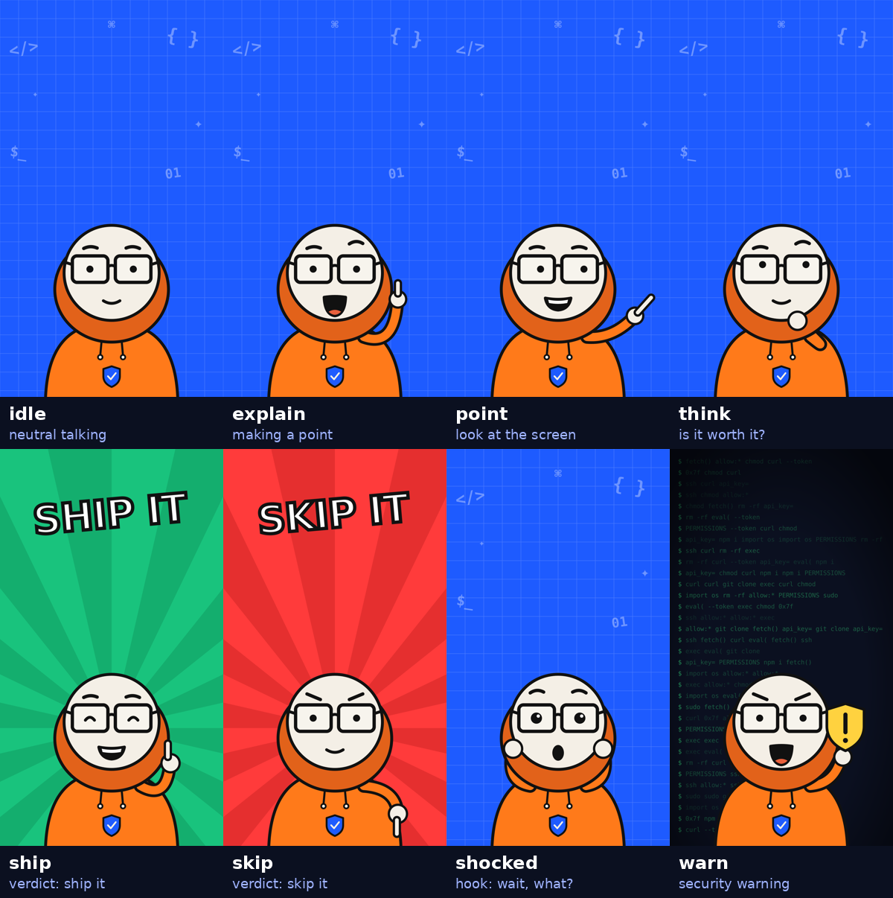

# Ship It or Skip It — reel pipeline

Turn a voiceover into a finished vertical explainer reel: a lip-synced cartoon host, animated UI cards, word-by-word captions, and verdict stamps. Everything is plain Python. No AI video credits, no After Effects.

This is the exact pipeline behind the **Ship It or Skip It** account, where Patch (the host) gives honest verdicts on AI tools.

<p align="center"></p>

## How it works

```
voice.mp3 ──► prep_voice.py ──► voice.wav + voice.words.json
                 │  (cut flubs, tighten pauses, loudness -14 LUFS, word timings)
                 ▼
specs/epXX.py ──► explainer.py ──► reel.mp4   (1080×1920, 30 fps)
 (headlines, cards,     │
  stamps, poses)        └─ lipsync.py: picks 1 of 4 mouth shapes per frame
                                        from loudness + brightness, adds blinks
```

- **The host** is drawn in SVG (`kit_lib.py`): 8 poses × 4 mouth shapes × blink. `make_kit.py` renders them to PNG.
- **The lip-sync** is not phoneme-based. It reads the audio 30 times a second: quiet means a closed mouth, loud means wide open, dark or low sounds give a round "O", and bright sounds give an "E". For flat cartoon style this reads as talking, but it won't match exact words.
- **The captions** come from [faster-whisper](https://github.com/SYSTRAN/faster-whisper) word timestamps, run locally.
- **Each video** is a small Python spec file: the scene list (headline, highlighted phrase, and the card to draw), the stamps, and the pose cues.

## Setup

Needs Python 3.10+ and [FFmpeg](https://ffmpeg.org/) on your PATH.

```bash
git clone https://github.com/Omar-xxx/ship-it-or-skip-it
cd ship-it-or-skip-it
pip install -r requirements.txt
python make_kit.py        # renders the host's poses, backgrounds, stickers (once)
```

The first `prep_voice.py` run downloads the Whisper `small.en` model, about 500 MB.

## Make a video

**1. Get a voiceover.** Record it yourself or generate it with any TTS tool. The account uses a cloned voice on Fish Audio, but the pipeline doesn't care where the audio comes from.

**2. Prep it.**

```bash
python prep_voice.py voice.mp3 ep05 --keep "skip it:0.5"
```

This prints every sentence with its start time. Use those times in your spec.

| Flag | What it does |
|---|---|
| `--cut "2.8-5.2,10.1-10.9"` | Removes spans (in seconds), e.g. a stutter or a line you don't want |
| `--keep "skip it:0.5"` | Keeps a 0.5 s dramatic pause before those words; other pauses are capped at 0.32 s |
| `--denoise` | For raw mic recordings: removes hum and light background noise |

**3. Write a spec.** Copy `specs/ep01_repo_trap.py` and edit three lists:

```python
SCENES = [   # start (s), headline, highlighted phrase, card
    (0.00, "This GitHub Repo", "Might Be a Trap", lambda t, lt: card_repo()),
    (40.30, "The Verdict", "Skip It", None),
]
STAMPS    = [(40.30, 41.5, "SKIP IT")]          # start, end, text[, color]
POSE_CUES = [(0, "shocked"), (8.7, "point"), (40.3, "skip")]
```

Optional, for the top bar (chapter label on the left, a counter on the right):

```python
CHAPTERS = ["the repo", "last commit", "the verdict"]        # one per scene
COUNTER  = ("RED FLAGS", [(0, "0"), (11.2, "1", (235, 59, 59))])  # label, [(start, value[, colour])]
```

A card is any function returning a PIL RGBA image. `t` is the video time and `lt` is the time since the scene started, so cards can animate. The helpers `card()`, `pill()` and `text_c()` live in `explainer.py`.

End card with a comment keyword: `card_cta("SAFE", "the setup checklist", lt)`. Pad the voice with ~2.5 s of silence (`ffmpeg -i v.wav -af apad=pad_dur=2.6 v_cta.wav`) so it can be read.

`make_dm_cards.py` renders the checklist images you DM to people who comment the keyword.

Poses: `idle` `explain` `point` `think` `ship` `skip` `shocked` `warn`.

**4. Render.**

```bash
python explainer.py ep05.wav ep05.words.json --spec specs/ep05.py --out ep05.mp4
```

A one-minute reel takes about 2 minutes on a laptop CPU.

| Flag | What it does |
|---|---|
| `--style classic` | The original layout: host inside a rounded box, highlighted phrase in a blue box. Default is `v4` (unboxed host, chapter bar, stacked cards) |
| `--frames "0,12.5,30"` | Saves PNG stills at those seconds instead of rendering, for checking a layout fast |

<p align="center"></p>

## Other tools

- `lipsync.py voice.wav --out patch.mp4` renders just the talking host on green screen, for keying in CapCut or another editor. Add `--layout scene --cues "0:shocked,3:point"` for the older full-frame layout.
- `tighten.py` is the pause tightener on its own.

## Music

Don't bake music into the export. Add trending audio inside Instagram or TikTok so it stays licensed, and keep it low under the voice.

## License

Code: MIT, see [LICENSE](LICENSE). Fonts in `fonts/` are under the SIL Open Font License; their license files are included there. The host character "Patch" and the Ship It or Skip It name are part of the account's branding. Please design your own character for your own channel.
